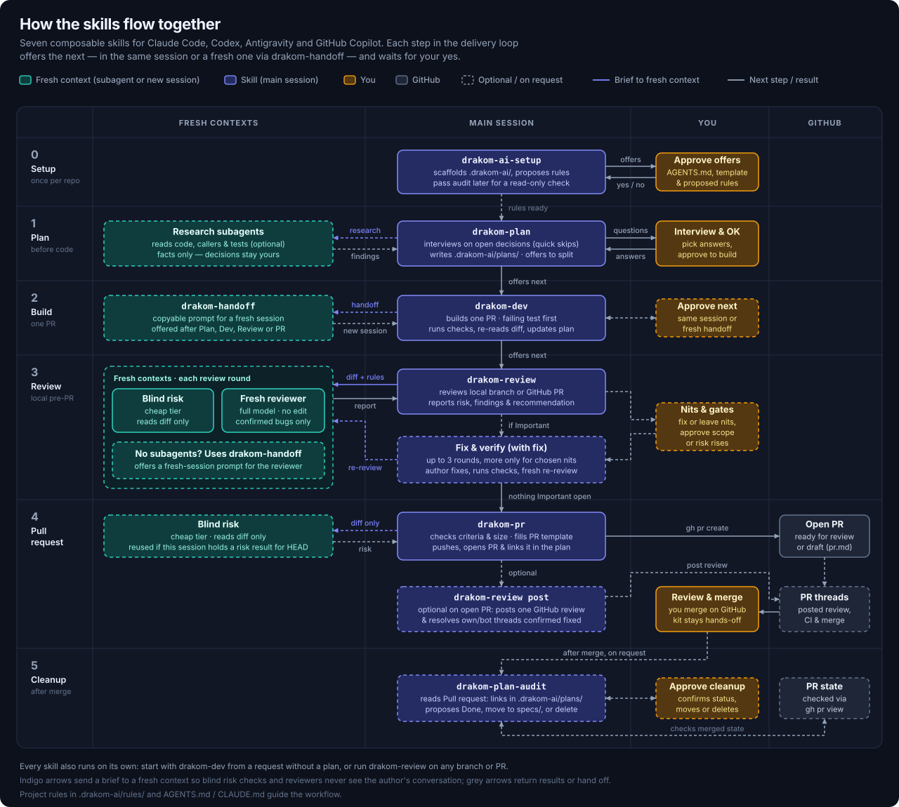

# Drakom AI Dev Kit

[](https://github.com/TDrake44/drakom-ai-dev-kit/actions)
[](LICENSE)

A set of agent skills for planning, building, reviewing and opening pull
requests, with project rules kept in one place, for Claude Code, OpenAI Codex,
Antigravity and GitHub Copilot.

I built this for my own hobby projects, to spend less time steering agents
through the same workflow and maintaining duplicate agent configuration.

## Quick start

Install the skills with the [`skills` CLI](https://github.com/vercel-labs/skills)
for every project on your machine (user level):

```bash
npx skills add TDrake44/drakom-ai-dev-kit -g
npx skills update -g    # later, to update
```

For one project (project level), run it in that project without `-g`; the
`skills` CLI then keeps its copies and a `skills-lock.json` in the project.

Then ask your AI assistant to run the setup skill in your repository:

```text
/drakom-ai-setup    # Claude Code, Antigravity, GitHub Copilot
$drakom-ai-setup    # OpenAI Codex CLI
```

It creates the `.drakom-ai/` folders, offers the rest of the context below and
proposes project-specific rules from repository evidence, writing each only on
your yes.

Coming from a version that used the `drakom-ai` command? Follow the one-time
cleanup in the [0.7.0 changelog entry](CHANGELOG.md#070).

## Included skills

| Skill | When to use it |
| --- | --- |
| `drakom-ai-setup` | Create the `.drakom-ai/` folders, offer an `AGENTS.md`, a pointer line, `.worktreeinclude` and a pull request template, each written only on a yes, and propose project-specific rules for approval. `audit` checks the existing rules and changes nothing unasked. |
| `drakom-plan` | Turn a request into a plan file before any code: an interview on the open decisions, each with a recommended answer (`quick` skips it), and an offer to split it into smaller plans when the work outgrows one pull request. The interview is adapted from Matt Pocock's [`grilling`](https://github.com/mattpocock/skills) skill (MIT). |
| `drakom-dev` | Build one pull request's worth of work from a plan or a request, test first, then run the repo's checks, re-read the diff and report. |
| `drakom-review` | Review a branch or pull request with a blind risk check and a fresh reviewer, once or in up to three fix rounds (`fix`), and post the report to the pull request as one Copilot-style review (`post`, GitHub only). |
| `drakom-pr` | Open a pull request on GitHub: a risk check from the diff alone, a description from the repo's template within its word budget (or a starter it offers once to add), and the link recorded in the plan; never merges, replies or resolves threads. |
| `drakom-handoff` | Write a prompt for a fresh session to pick up the next step, printed in the chat to copy. |
| `drakom-plan-audit` | Review or clean up local plans when explicitly requested, such as after pull requests merge. |

## How the skills flow together



`drakom-plan`, `drakom-dev` and `drakom-review` each finish by offering the next
step — in the same session or in a fresh one through `drakom-handoff` — and
wait for your yes; `drakom-pr` does so when the repo's rules say what follows
an opened pull request. Every skill also runs on its own (for example,
`drakom-dev` straight from a request without a plan, or `drakom-review` on an
existing branch or pull request).

## Project layout

```text
.drakom-ai/
  .gitignore             # Ignores plans/ and assets/
  rules/                 # Project-owned policies and the optional extension files
  plans/                 # Local, ignored scratchpads
  specs/                 # Shared specifications and decisions
  assets/                # Local, ignored screenshots and logs
AGENTS.md / CLAUDE.md    # Agent entry points
.worktreeinclude         # Copies the ignored plans and assets into new worktrees
```

Any rule file can go in `.drakom-ai/rules/`; the skills load it when `AGENTS.md`,
`CLAUDE.md` or `.drakom-ai/rules/README.md` routes to it. Six names there are
optional extension files the skills find on their own: `verification.md`,
`review.md`, `plan.md`, `dev.md`, `pr.md` and `handoff.md`. The `rules/README.md`
that setup writes says what each holds.

The [workflow guide](docs/agent-workflows.md) covers the layout, rules and
worktrees in more detail. See the [changelog](CHANGELOG.md) and
[GitHub Releases](https://github.com/TDrake44/drakom-ai-dev-kit/releases) for
release history and the [security policy](SECURITY.md) for vulnerability
reporting.

## Development

From a checkout of this repository, with Node.js 24 (see `.nvmrc`) and pnpm:

```bash
pnpm install --frozen-lockfile
pnpm lint
pnpm typecheck
pnpm test
```

To try a skill change before it merges, install it from the checkout with
`npx skills add ./ -g --skill <name>`.

## License

[MIT](LICENSE)
